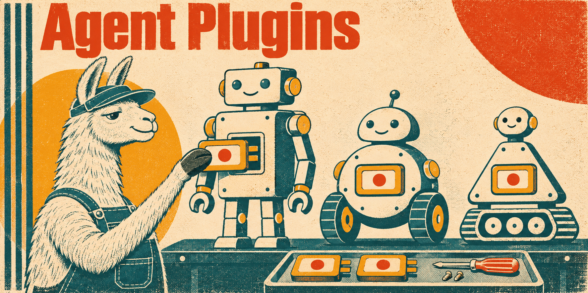

# Agent plugin skills

Extending agent harnesses across clients rather than for one of them: runtimes,
setup and update behaviour that a Claude Code, Codex or Hermes plugin shares.
Client-specific plugin skills stay with their client in
[claude](../claude/README.md), [codex](../codex/README.md) and
[hermes-agent](../hermes-agent/README.md).

## [getty-bun-integration](getty-bun-integration/SKILL.md)

Integrating Getty's shared per-user Bun runtime into agent plugins and tools — an
engineering specification for the Getty contract proposal, not an installed provider.
One exact Bun version per consumer `package.json`, one verified installation per
version and target, execution through a resolved absolute path, an OS-backed mutex
with `.installing` records during installation, explicit dependency provisioning from
`bun.lock`, side-by-side updates with rollback. References cover the contract, paths
and platforms, setup instructions, Claude Code and Codex adapters, locking,
retention, verification and prior art; assets hold a package fragment, a JSON schema,
a setup-skill template and a review template.

**Load when** an agent plugin or tool must run TypeScript on the shared Bun runtime,
or when reviewing such an integration.
