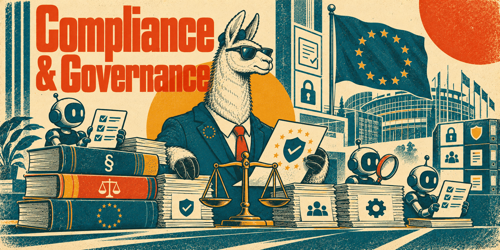

# Compliance & governance skills

EU law for an AI platform, turned into engineering work: which rules apply to a
feature, which control satisfies them, and which evidence shows it. The suite is one
entry point and thirteen specialists. Each keeps an EU core separate from a national
overlay — Germany is the overlay supplied; any other Member State needs its own,
verified, and German thresholds or exceptions are never exported to another country.

What the skills share:

- **Applicability before checklists.** Every requirement goes through
  `fact → source/provision → applicability → obligation → control → evidence → owner →
  review trigger`. Applicability is `applicable`, `not_applicable`, `conditional` or
  `unknown`; a missing fact is never an exemption.
- **Law, guidance, standard, contract and policy kept apart**, and so are entry into
  force, application date and transitional population. A proposal is not law until it
  is enacted and applicable.
- **No certification.** No compliance percentage, no "all laws checked", no invented
  approvals, DPO signatures or conformity assessments. Release outcomes are
  `ready_for_authorised_review`, `ready_with_nonblocking_followups`, `blocked` and
  `insufficient_evidence`.
- **Authority stays with people.** Authorised reversible engineering continues; notices
  to authorities, customers or rights holders, signatures, filings and live financial
  actions are prepared, never sent.

Research snapshot for the whole suite: 2026-10-22. Every skill tells the agent to
refresh primary sources before a consequential decision. These are reference skills —
they describe the law and how to engineer against it, not a house choice — so none
carries the `getty-` prefix.

## Entry point and process

### [eu-platform-compliance](eu-platform-compliance/SKILL.md)

The router. Builds the platform profile — legal entity, roles per purpose, markets,
feature inventory — and the applicability register, then routes each changed surface
to the specialist that owns it. Works in three passes: architecture and launch, a
changed feature or pull request, and operation. Ships the platform profile, a
decision record, a control register and the suite manifest.

**Load when** scoping compliance for an EU AI platform, preparing a launch or
expansion, or when a change touches several legal domains and it is unclear which
specialist applies.

### [eu-platform-agent-assurance](eu-platform-agent-assurance/SKILL.md)

Turns legal decisions into testable controls and review evidence for agent-built
software: no single agent is author, tester, legal interpreter and approver of its own
material change. Covers PR review, release gates bound to a release and environment,
adversarial and negative tests, agent permissions and runtime drift signals. Ships an
offline evidence-consistency checker (`check_evidence.py`, stdlib only) whose exit 0
means declared evidence is consistent — not that any law is satisfied.

**Load when** reviewing a PR or release for compliance evidence, wiring an evidence
gate into CI, or scoping what an agent may do on a regulated platform.

### [eu-platform-regulatory-watch](eu-platform-regulatory-watch/SKILL.md)

A versioned source register and change-impact process: retrieve the operative text,
separate a textual change from a legal change and a legal change from a platform
impact, then hand a concrete change packet to the owning control. Ships an offline
register checker (`review_sources.py`) that validates dates, statuses and review gaps
without touching the network. Installs no scheduler on its own.

**Load when** refreshing legal sources, assessing a new amendment, proposal or
guidance document, or checking whether a deadline still holds.

## Personal data

### [eu-platform-privacy](eu-platform-privacy/SKILL.md)

GDPR for AI, SaaS, B2C and B2B: controller and processor roles per purpose, lawful
bases with Article 9/10 conditions, RoPA, DPIA and DPO screening, notices,
data-subject rights, consequential automated decisions, privacy by design and personal
data breaches. Germany's BDSG is the overlay; the UK and Switzerland are separate
scopes. Business customers, public-web data, hashes and vectors are not outside the
GDPR by default.

**Load when** a feature processes personal data, a role or lawful basis is in
question, or a DPIA, rights request or breach is on the table.

### [eu-platform-data-governance](eu-platform-data-governance/SKILL.md)

The data lifecycle: inventory, retention, deletion including derivatives, backups and
provider copies, RAG and vector data, training and evaluation provenance,
anonymisation, processors and subprocessors, and international transfers (SCCs,
transfer assessments, adequacy, EU-US DPF). Paper commitments are reconciled against
API settings and observed request routes. Ships a data register, an erasure runbook
and a vendor transfer review.

**Load when** defining retention or deletion, onboarding a vendor or model provider,
moving data across borders, or governing RAG and training data.

### [eu-platform-tracking-marketing](eu-platform-tracking-marketing/SKILL.md)

Three permissions kept separate — terminal access (ePrivacy Art. 5(3), in Germany the
TDDDG), the following personal-data processing, and the permission to contact (UWG).
Covers cookies, local storage, fingerprinting, SDKs, CMPs, server-side tagging, pixels,
session replay and email, SMS and phone campaigns. "Cookieless", "server-side" and
"B2B" are not exemptions; a banner screenshot does not prove tracking was blocked.

**Load when** adding analytics, tracking or advertising code, auditing a consent
banner, or reviewing a marketing campaign.

## AI-specific

### [eu-ai-act](eu-ai-act/SKILL.md)

AI Act classification and engineering per feature, actor and model version: roles,
prohibited practices first, high-risk under Article 6 and the Annexes, Article 50
transparency paragraph by paragraph, GPAI duties, model changes, AI literacy,
conformity evidence and post-market monitoring. Uses the timeline as amended in 2026
(Digital Omnibus) and the German authority allocation; an unamended 2024 timeline is
not to be reused.

**Load when** classifying an AI feature or model, checking an AI Act deadline, or
building transparency, marking or high-risk controls.

### [eu-ai-data-ip](eu-ai-data-ip/SKILL.md)

Rights for each actual use of each asset — training data, RAG sources, web ingestion,
model weights, dependencies and generated outputs — with German copyright (UrhG
§§ 44b, 60d, 87c) and trade-secret overlays. Copyright permission, privacy basis,
contractual access and technical authorisation are four separate questions. Ships an
asset rights record, a rights review and a model licence review.

**Load when** onboarding a dataset or model, scraping, fine-tuning, reviewing a licence
or output claim, or handling a rights-holder complaint.

## Commerce, contracts and money

### [eu-platform-consumer-commerce](eu-platform-consumer-commerce/SKILL.md)

B2C sales of AI and SaaS: consumer status from the actual transaction, pricing and
order button, durable-medium confirmation, and the exit paths kept apart — withdrawal,
ordinary cancellation, extraordinary termination, digital-product remedies and account
deletion. German adapter for BGB §§ 312 ff. and 327 ff., EGBGB, PAngV and VSBG,
including the § 356a withdrawal function and the § 312k cancellation button.

**Load when** building signup, checkout, subscriptions, renewals, cancellation or
consumer-facing terms, or when a model or quota change affects paying consumers.

### [eu-platform-business-contracts](eu-platform-business-contracts/SKILL.md)

Both directions of the B2B supply chain — what the platform buys and what it promises.
Every material promise becomes an owner, a control and a record: DPAs and AVVs, SLAs,
security schedules, model-provider terms, acceptable use, licensing, audits,
subcontractors, regulated customers, and Data Act switching and exit as a separate
assessment.

**Load when** reviewing an enterprise contract, a vendor's terms or a customer
security questionnaire, or when a contract change has to reach code or operations.

### [eu-platform-billing-tax](eu-platform-billing-tax/SKILL.md)

Usage metering, contract charges, tax classification, invoicing and payment kept as
separate steps, with tax policy applied deterministically rather than by a model per
transaction. Covers place of supply, OSS, reverse charge, German structured
e-invoicing and its phased transitions, retention, PSP integration, prepaid credits,
wallets and the payment-regulation screen.

**Load when** building metering, invoices, VAT handling, e-invoicing, credits or
payouts, or deciding how long accounting records are kept.

## Product duties

### [eu-platform-accessibility](eu-platform-accessibility/SKILL.md)

EAA scope with Germany's BFSG and BFSGV as the adapter, then complete user journeys —
signup, payment, cancellation, AI chat and streaming, agent approval dialogs, exports —
tested by automated checks, keyboard and screen reader. Tracks the standard edition
and its Official Journal citation separately; a scanner result or overlay is never a
conformance claim.

**Load when** a consumer-facing UI, checkout or AI interface is built or changed, or an
accessibility statement or exemption is due.

### [eu-platform-content-safety](eu-platform-content-safety/SKILL.md)

DSA classification per feature — private chat, private hosting, public share links,
galleries, marketplaces — then notices, moderation decisions, statements of reasons,
appeals, minors, AI output safeguards, DSA reporting, e-evidence and government
orders. German DDG and JMStV/JuSchG overlays. Platform status comes from the facts,
not the product's marketing name.

**Load when** users can publish or share content, a marketplace or agent store is
added, minors may be present, or a takedown or authority order arrives.

### [eu-platform-cybersecurity](eu-platform-cybersecurity/SKILL.md)

Security duties turned into controls and evidence: tenant isolation, AI tools and RAG,
secure development and supply chain, vulnerability handling, CRA scope for anything
downloadable, customer security duties, incident response and reporting clocks.
Conditional NIS2 (German BSIG overlay) and CRA are kept apart from general GDPR
security. A certification or a clean scan is not proof of statutory compliance.

**Load when** designing or reviewing platform security, shipping a client, agent or
self-hosted edition, or handling an incident with a reporting clock.
