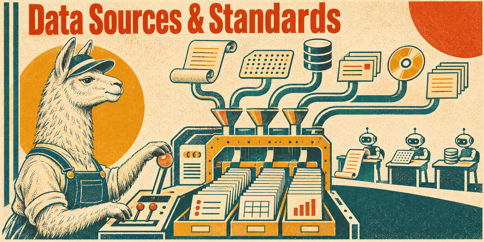

# Data sources & standards skills

Data that arrives from outside, and the standards it is written in — open datasets
with a data model of their own, and the exchange formats, identifiers and
vocabularies of individual domains. Each skill explains what a record means, how to
acquire and validate it, and what its licence allows, without assuming a storage
system. The general graph stack (RDF, OWL, SHACL, SPARQL) lives in
[semantic-web](../semantic-web/README.md).

## [wikibase-data](wikibase-data/SKILL.md)

The Wikidata and Wikibase data model: entity JSON, the APIs, dumps and RDF exports,
statements with ranks, snaks, qualifiers and references, typed values, truthy
projections, redirects and deletions, update streams, and reconciliation against
other identifiers.

**Load when** exporting from or ingesting Wikidata or a Wikibase instance, or when an
import loses ranks, qualifiers, references or deleted entities.

## [openstreetmap-data](openstreetmap-data/SKILL.md)

OpenStreetMap as data: nodes, ways, relations and tags, PBF and XML extracts,
OsmChange updates, geometry assembly, identity links to other datasets, and which
service answers which question — geocoding, routing, map delivery. Covers
provenance, completeness and the ODbL obligations.

**Load when** acquiring, filtering, updating or joining OSM data, or when deciding
what a product built on it owes under the licence.

## [geospatial-standards](geospatial-standards/SKILL.md)

Geographic information standards: coordinate reference systems and axis order, OGC
Simple Features, WKT and WKB, GeoJSON, GeoPackage, GeoParquet, GeoSPARQL and OGC API
Features, with containment and distance queries.

**Load when** exchanging or querying spatial data, choosing a format, or when
coordinates land in the wrong place or a geometry fails validation.

## [financial-identifiers](financial-identifiers/SKILL.md)

Financial reference identifiers: LEI and GLEIF records with their relationship data,
ISIN, MIC, CFI, FISN and tickers. Keeps entity, instrument and listing identity
apart, and covers authoritative mappings, checksums, lifecycle changes, and the
data-access and licensing boundaries of each scheme.

**Load when** selecting, validating, looking up or reconciling identifiers for legal
entities, securities or trading venues.

## [xbrl-reporting-standards](xbrl-reporting-standards/SKILL.md)

XBRL business reports and taxonomies: XBRL 2.1, Dimensions, Inline XBRL, the Open
Information Model with xBRL-JSON and xBRL-CSV, facts and contexts, units and
accuracy, duplicate facts, DTS discovery, taxonomy extensions and packages, and
jurisdiction-specific filing profiles such as SEC and ESEF.

**Load when** reading, producing, converting or validating XBRL filings, or
ingesting reported facts into another model.

## [fibo-integration](fibo-integration/SKILL.md)

The Financial Industry Business Ontology as a vocabulary of financial concepts:
modules and exact IRIs, releases and the OWL import closure, legal entities and
roles, instruments and listings, mappings from a source model, and extensions. Keeps
the ontology apart from operational records — a definition of "issuer" does not say
who issued a bond.

**Load when** looking up a FIBO definition, aligning a data model with FIBO, or
loading, pinning or extending a release.

## [gs1-epcis](gs1-epcis/SKILL.md)

GS1 EPCIS 2.x and the Core Business Vocabulary for traceability: event types,
business steps and dispositions, GS1 identifiers and Digital Link, aggregation and
transformation, timestamps and corrections, sensor data, the JSON-LD and XML
bindings, and the capture and query interfaces.

**Load when** modeling, exchanging, inspecting or validating supply-chain events, or
when two parties' EPCIS data does not line up.

## [iptc-news-standards](iptc-news-standards/SKILL.md)

IPTC news exchange: NewsML-G2 and ninjs, NewsCodes and Media Topics, RightsML
metadata, multimedia packages, provider identifiers, item revisions, corrections,
cancellation and embargo, multilingual metadata, and taxonomy mapping. Extraction of
reported claims and events keeps its evidence.

**Load when** creating, converting, ingesting or validating news items, or mapping a
provider's subject codes to another taxonomy.
