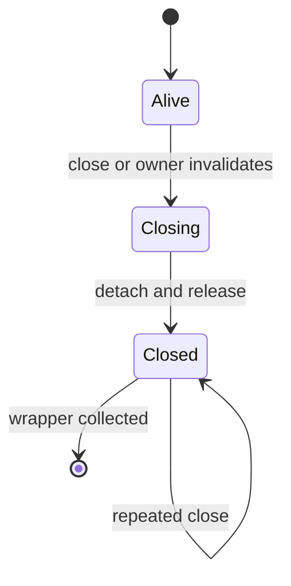

# Native lifetime, callbacks, and asynchronous work

Use when scripts retain host objects, native code retains Lua callbacks, coroutines wait for external work, or a C++ application crashes during error handling or shutdown.

## Contents

- [Define ownership at each boundary](#define-ownership-at-each-boundary)
- [Root Lua values deliberately](#root-lua-values-deliberately)
- [Model native object validity](#model-native-object-validity)
- [Resource cleanup and C++ unwinding](#resource-cleanup-and-c-unwinding)
- [Async completion protocol](#async-completion-protocol)
- [Teardown and reentrancy](#teardown-and-reentrancy)
- [FFI-specific risks](#ffi-specific-risks)
- [Diagnostic cases and sources](#diagnostic-cases-and-sources)

## Define ownership at each boundary

Use an explicit ownership table in the design or review:

| Relationship | Owner | Required release/invalidation action |
|---|---|---|
| Lua owns a native resource | Full userdata or wrapper | Idempotent close; finalizer fallback |
| Lua borrows a native object | Native subsystem | Invalidate handle before native destruction |
| Native code retains a Lua callback | Subscription/request owner | Strong registry reference; unregister and unref |
| Async operation retains native input | Task/request record | Copy or transfer ownership until completion/cancellation |
| Coroutine waits for work | Scheduler | Strong root, status, cancellation route, terminal cleanup |
| Two runtimes exchange data | Message protocol | Copy/serialize allowed values; explicit identities |

These are recommended contracts. Neither placing a pointer in userdata nor returning a Lua table automatically supplies them.

## Root Lua values deliberately

PUC Lua traces its own reachable objects. Native references must use a Lua-visible root, such as a registry reference created with `luaL_ref`; release it with `luaL_unref` when the native owner is finished. Holding only a C pointer to a collectable Lua object is insufficient. A coroutine created with `lua_newthread` shares its state's environment and must remain reachable while native code expects to resume it. [Registry](https://www.lua.org/manual/5.4/manual.html#4.3); [`luaL_ref`, `luaL_unref`](https://www.lua.org/source/5.5/lauxlib.c.html); [`lua_newthread`](https://www.lua.org/source/5.5/lstate.c.html#lua_newthread).

Recommended subscription record:

```text
subscription_id
session_generation
lua_callback_reference
native_subscription_token
active_or_cancelled
```

Release in a defined order: mark inactive, disconnect the native producer, prevent or drain in-flight callbacks, then unreference the Lua callback. “Disconnect” must have a documented guarantee about already queued callbacks; otherwise stale completion checks are still necessary.

Keep Lua string buffers alive for the complete native use, or copy them. Treat a pointer obtained from an API as borrowed unless that API explicitly transfers ownership. Specify whether the callee reads the bytes synchronously or stores the pointer.

## Model native object validity

For externally owned objects, prefer a resolvable handle such as `(object_id, generation)` over a raw pointer exposed throughout scripts. Each operation resolves the handle through the native owner and checks its generation. The generation prevents a deleted object's ID from silently referring to a newly allocated object.

Define the failure behavior for stale handles: return `nil, reason`, raise a domain error, or issue a harmless rejection. Apply the same policy to event callbacks and bulk operations. Do not silently recreate deleted objects on access.

A useful native wrapper state machine is:



Do not give a finalizer and an explicit close method independent ownership of the same resource. Both should enter the same idempotent release path. The wrapper must become unusable even if a cleanup step reports a failure.

## Resource cleanup and C++ unwinding

PUC Lua compiled as C normally uses `longjmp` for errors; when compiled as C++, its source selects a C++ exception path unless configured otherwise. The actual `LUAI_THROW`/`LUAI_TRY` configuration matters. A long jump across a C++ frame that relies on nontrivial destructors is not an ordinary RAII return path. [Error model](https://www.lua.org/manual/5.5/manual.html#4.4); [`ldo.c` error-recovery macros](https://www.lua.org/source/5.5/ldo.c.html).

Review every binding for these crossings:

- A `luaL_check*` or allocating API call occurs while a native lock, container, or smart pointer needs unwinding.
- A native function throws through a Lua C frame that was not compiled for that exception model.
- A yield abandons a C stack frame containing task state.
- A destructor or finalizer calls back into Lua during a partially completed mutation.

Choose one consistent boundary strategy: perform potentially raising Lua work outside scopes that require C++ destruction, or use a tested exception-compatible runtime/binding arrangement. Catch host exceptions at the intended binding boundary and convert them into the project's error contract. Do not assume `extern "C"` provides exception safety; it controls linkage.

LuaJIT has a separate, platform/toolchain-dependent unwinding contract. Its documented external-frame-unwinding configurations support full C++ exception interoperability; internal unwinding with DWARF2 and Windows 64-bit non-MSVC configurations are listed as limited. In limited mode, Lua errors do not invoke C++ destructors, and foreign exceptions can lose their original identity. Other listed configurations have no interoperability and cannot safely propagate C++ exceptions across Lua frames. Verify the selected build against the current table and exercise the actual binding; do not transfer a successful PUC or desktop test to every LuaJIT target. [LuaJIT C++ exception interoperability](https://luajit.org/extensions.html); [C-function wrapper API](https://luajit.org/ext_c_api.html).

Lua's `__gc` runs when the collector schedules finalization. In 5.4+, `__close` supports lexical cleanup, but cancellation of suspended work still needs an explicit lifecycle. Cleanup order and error behavior must be designed for locks, file handles, GPU resources, and foreign event subscriptions. [`luaF_close`, `callclosemethod`](https://www.lua.org/source/5.5/lfunc.c.html); [closing variables](https://www.lua.org/manual/5.4/manual.html#3.3.8).

## Async completion protocol

Use this sequence for a host-owned operation:

1. Validate arguments on the Lua owner thread.
2. Allocate a durable request record with operation ID, session generation, cancellation flag, and callback/coroutine reference.
3. Start native work using copied or owned input.
4. On completion, enqueue a plain result message to the Lua owner's queue.
5. On that thread, verify that the session and request are still active.
6. Convert the result and invoke/resume under a protected boundary.
7. Release the request and Lua reference exactly once on every terminal path.

The completion path may race with cancellation. Make terminal ownership explicit: either cancellation consumes the request, completion consumes it, or both compete through one idempotent state transition. Do not let a second completion resume a dead coroutine.

A coroutine is cooperative execution, not a detached OS thread. A native worker must not directly enter a state already executing elsewhere. The default engineering approach is one owner thread per state and a message queue; wrappers may impose additional constraints. [sol threading guidance](https://sol2.readthedocs.io/en/latest/threading.html); [PUC coroutine API](https://www.lua.org/manual/5.5/manual.html#lua_resume).

## Teardown and reentrancy

Recommended shutdown order:

1. Stop accepting new script work.
2. Mark the session generation invalid.
3. Stop or cancel external producers.
4. Close/cancel suspended tasks according to the exact runtime's API.
5. Release native callback subscriptions and registry references.
6. Close the state; destroy its native owner afterward.

Never call `lua_close` while a foreign thread can still enqueue a raw `lua_State*`. Queue messages should address a durable session ID that can be rejected after shutdown.

Keep native libraries loaded while any Lua C closure, userdata finalizer, buffer-release callback, retained callback, or suspended task can still enter their code. Clearing a module cache or switching a script generation does not retire those references. Coordinate library release with callback disconnection and VM/resource teardown; see `deployment-and-native-modules.md`. LuaJIT also requires a loaded-library namespace to remain alive while its function pointers are used. [FFI library-namespace lifetime](https://luajit.org/ext_ffi_semantics.html).

Reentrancy is independent of multithreading. A native callback can invoke Lua, which calls the host again before the original operation finishes. Identify the mutation boundary, queue events until invariants are restored, or explicitly support reentrant execution. Avoid firing arbitrary script callbacks while iterating a container that those callbacks can mutate.

An error after a host mutation does not undo the mutation. For example, an external action may succeed before allocating its Lua return value fails. Define the operation's commit point, retry/idempotency behavior, and reconciliation route; a protected Lua call only supplies an error boundary. Preserve committed-operation identity separately from result formatting when retries are possible. This is a host transaction-design requirement, not a rollback guarantee from Lua's protected-call API. [Protected-call contract](https://www.lua.org/manual/5.5/manual.html#lua_pcall).

## FFI-specific risks

LuaJIT's FFI does not make native pointer graphs visible to the collector. Keep the owning cdata object alive separately from pointers into it. Explicitly allocated callbacks need a defined free point; an implicit conversion to a callback can permanently retain callback resources. A JIT-compiled FFI call that later calls back into Lua can also require disabling JIT for the surrounding call path. These are LuaJIT-specific rules. [FFI semantics: GC and callbacks](https://luajit.org/ext_ffi_semantics.html#gc).

Treat the C declaration, ABI, calling convention, buffer length, and library lifetime as part of the binding. A declaration that compiles is not evidence that it matches the native function.

## Diagnostic cases and sources

For a retained callback, reproduce: native owner destroyed first; Lua owner destroyed first; cancellation just before completion; duplicate completion; callback raising; callback requesting another operation; repeated subscribe/unsubscribe; shutdown with pending work. Use a native memory checker or sanitizer where the target supports it.

Primary sources checked 2026-11-22:

- [PUC registry and C API](https://www.lua.org/manual/5.4/manual.html#4), [5.5 C API](https://www.lua.org/manual/5.5/manual.html#4).
- [5.5.1 state implementation](https://www.lua.org/source/5.5/lstate.c.html), [auxiliary references](https://www.lua.org/source/5.5/lauxlib.c.html), [error recovery](https://www.lua.org/source/5.5/ldo.c.html), [closing implementation](https://www.lua.org/source/5.5/lfunc.c.html).
- [LuaJIT FFI semantics](https://luajit.org/ext_ffi_semantics.html), [C++ exception interoperability](https://luajit.org/extensions.html), [C-function wrapper API](https://luajit.org/ext_c_api.html).
- [sol threading](https://sol2.readthedocs.io/en/latest/threading.html).
