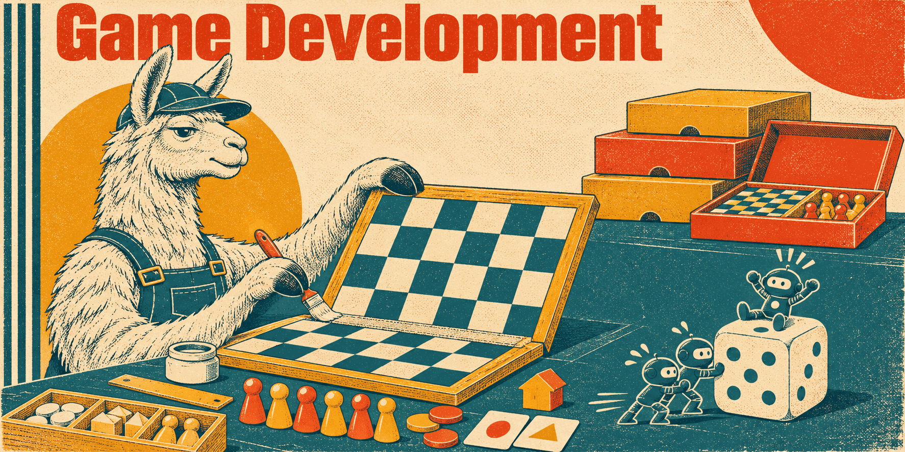

# Game development skills

Building games that machines can play and that are balanced by measurement — the
seat interface for bots and LLM agents, the simulation as a balance instrument, the
numbers inside the systems, the terrain units stand on and how they find their way.
Engine and genre independent; written with strategy
and economy simulations in mind, where bots playing thousands of games replace much
of the early playtesting.

## [ai-playable-games](ai-playable-games/SKILL.md)

The contract that makes a game playable by scripted bots, search AIs and LLM agents
through the same seat as a human: a pure deterministic core, per-seat views computed
on the server, typed orders with explicit rejection codes, preview of every order,
simultaneous ticks with deadlines and standing orders, and a logged `reason` per order.

The LLM part covers what a default design misses: an adapter over the seat protocol
(which maps directly onto an MCP server), a persisted notes slot, cadence and token
budgets, replaying recorded orders instead of re-querying the model, and treating
player-written text (names, diplomacy, chat) as untrusted data so that other players
cannot prompt-inject an AI seat. A leak test proves each seat sees only what it may know.

**Load when** designing or reviewing the bot/agent interface of a game or simulation,
adding AI seats, or when an AI player cheats, stalls or misreads the state.

## [simulation-balancing](simulation-balancing/SKILL.md)

The simulation as a measuring instrument: determinism test and run records, a
deliberately diverse policy league (random-legal to exploit-seeker and LLM seat),
Nash-averaged evaluation, paired before/after runs on identical seeds, sample sizes
for win rates, and strategy-game metrics such as decisiveness tick, comeback rate
and binding-constraint share.

Its core is a four-stage procedure for "does this mechanic matter?" (exercise,
sensitivity, ablate, verdict) that separates a dead mechanic from a blind instrument,
and a report template that states each result together with what the bots cannot see.

**Load when** balancing through bot or AI-vs-AI runs, asking whether a mechanic can be
cut, or when a change shows no effect in the sim.

## [game-balance-math](game-balance-math/SKILL.md)

The numbers inside the systems: an economy as a flow graph with a per-tick
conservation check and negative-cycle detection for infinite-money loops; feedback
loops and the snowball problem of strategy games, including kingmaking; cost curves
with weights measured in the sim and Lanchester's square law as the reason stats do
not add up in combat; payoff matrices checked by dominance and Nash support instead
of row sums; and the order of remedies for a dominant option.

**Load when** pricing units, ships, buildings or upgrades, designing counters or an
economy, or chasing inflation, hoarding, runaway leaders or one strategy that always wins.

## [game-pathfinding-navigation](game-pathfinding-navigation/SKILL.md)

Routes for units and agents, from the smallest model that works upward: graphs,
grids and navmeshes, agent profiles with clearance and directed costs, BFS, Dijkstra
and A* with admissible heuristics, hierarchy and landmarks, D* Lite repair when the
world changes, flow fields for many units and one goal, path following and local
avoidance, reservations and multi-agent pathfinding, streamed worlds, and adapters
for Recast, Unity, Unreal and Godot. Terrain, buildings and logistics stay outside
and arrive through explicit contracts. Ships a reference implementation with tests.

**Load when** units take wrong, slow or blocked routes, a navigation model has to be
chosen or replaced, or many agents must share narrow space without deadlock.

## [polygon-terrain-simulation](polygon-terrain-simulation/SKILL.md)

Editable terrain on a polygon or Voronoi mesh that stays physically consistent:
generation from noise, painted elevation and climate, layered soils and bedrock with
mass bookkeeping, excavation, fill and building pads, surface water with lakes, dams
and culverts, optional groundwater, erosion, sediment and channel migration, map
rendering, and saving and streaming a world that keeps changing. Construction,
logistics and population stay outside and trade material through explicit contracts.
Ships reference math and a snapshot audit with tests.

**Load when** a game's terrain must change at runtime — digging, flattening, rerouting
water — or a generated world needs rivers, lakes and soils that hold together.
