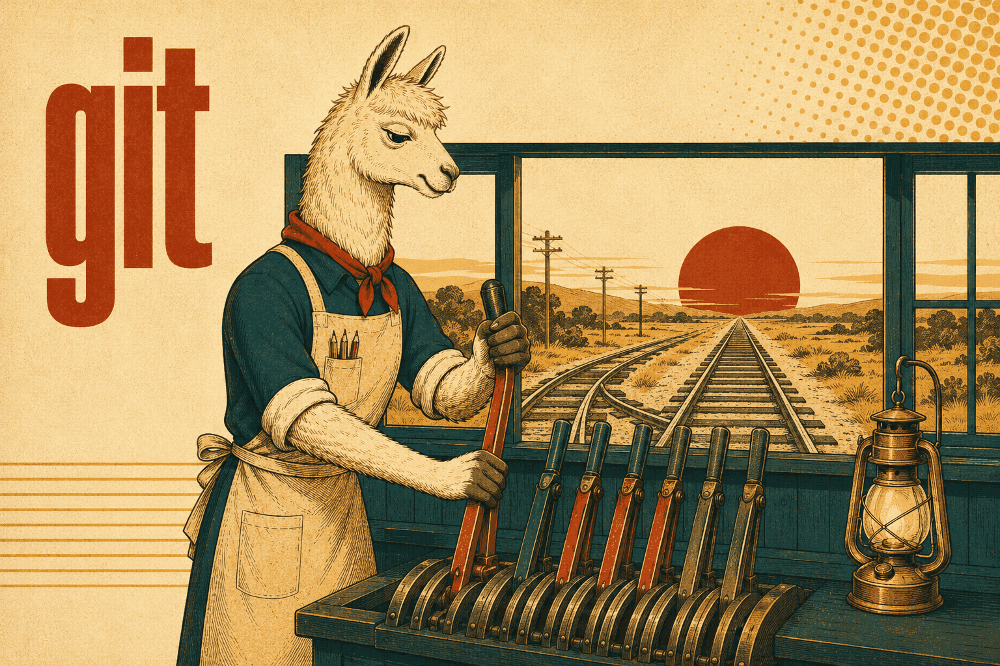

# Git skills

How Getty's repositories are used, and how their commit messages are written — two
different concerns kept as two skills so either can be loaded without the other.

## [getty-git-usage](getty-git-usage/SKILL.md)

Short version: **keep the history linear.** A branch lands rebased, not merged, and
a force-push after a rebase is always `--force-with-lease`.

Covers why a pull request lands with `--rebase` rather than squashed (squashing folds
the small commits into one and takes `git bisect`, a one-commit revert and
cherry-picks with them), and how stacked branches behave when the lower one lands —
GitHub closes the dependent PR and refuses to reopen it. Merge commits are not
forbidden, just not the default.

It also states the cadence: **commit early and commit often**, one finished piece of
work per commit down to a typo fix. Who commits follows the house rule
`agent-delegation`; a local commit of finished work needs no separate go-ahead —
pushing is the decision that waits. Shared skills under `.claude/skills/` are
installed by skilletor and stay out of git: a repo commits its `skilletor.json` and
the skills it owns, and a shared skill git still tracks gets untracked, not committed.
Before a push the repo's own checks run, and history already on `main` is never
rewritten.

**Load when** landing or pushing a branch, cleaning up history before a PR, or working
with stacked branches. Not preloaded: it is installed in the project and loads on
demand.

## [getty-git-commit-style](getty-git-commit-style/SKILL.md)

The norm for every commit message and `Changes` entry. The format: a summary line
under ~72 characters, either imperative or `<component>: <what>` — the component says
where the change lies (`ack-team check:`, `README:`); a `feat:`/`fix:` type prefix,
which says what kind of change it is, stays out, and a place named like a type is
written as its path (`docs/plan.md:`, never `docs:`). Then a body with one line per
discrete change — no bullets, no prose, no "This commit…". No `--signoff`, so no
`Signed-off-by:` line; the trailer is the co-author line.

The rule that carries the most weight is completeness: every file-level change gets
named, nothing silently lumped together. State *what* changed, never why it matters
or how it works — the diff shows that. Includes the `@`-symbol trap (GitHub reads
`@word` as a user mention, so a bundle is written `[DBIO]`, never `[@DBIO]`), the
co-authorship trailer naming the model that actually did the work, and passing
messages via HEREDOC so the formatting survives the shell.

Every repo that cuts releases keeps one `Changes` file in the CPAN format, Perl or
not: `{{$NEXT}}` for the unreleased section, a version line with the UTC time below
it for each release, and a `CHANGELOG.md` converted rather than kept beside it. An
entry follows the commit rules, plus three an ever-open unreleased section needs: **one topic, one entry** — touching an area again rewrites
the bullet already there instead of appending a second; **describe the destination,
not the journey**, since the reader never saw the old behaviour and the reasoning
already has homes that keep it; and **reference only the tracker the repo
publishes** — an internal board number has no reader outside the workspace and, written
as `#254`, resolves against the platform's own issue 254, where it is a dead link or,
later, someone else's bug.

Across several repos each repo gets its own commit. A product repo's message names no
other repo, except a card on another board in that board's notation
(`agent-developer k3`); a hub repo names its family's commits, since recording the
state across repos is its job.

**Load when** committing — writing or amending a commit message or a `Changes` entry.
Whoever commits has it loaded: the release-manager preloads it, the house rule
`agent-delegation` points every other committer at it.
