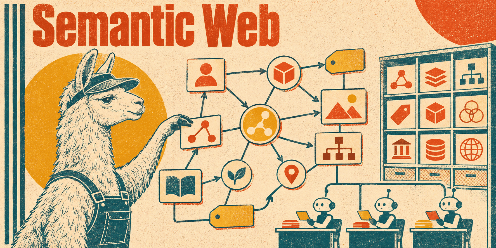

# Semantic web skills

The W3C stack for graph data — the data model, its JSON syntax, ontologies,
vocabularies, validation, querying and provenance. Each skill covers one standard on
its own terms, independent of any RDF store or library. Domain data that is merely
published as RDF lives in
[data-sources-and-standards](../data-sources-and-standards/README.md).

## [rdf-linked-data](rdf-linked-data/SKILL.md)

The foundation the other skills build on: triples and datasets, IRIs, blank nodes,
literals and datatypes, RDFS vocabularies and entailment, the Turtle, TriG, N-Triples
and N-Quads serializations, graph identity, and publishing Linked Data. Keeps RDF 1.1
and RDF 1.2 apart.

**Load when** modeling, parsing, transforming or publishing RDF, or when two graphs
that look the same do not compare equal.

## [jsonld-processing](jsonld-processing/SKILL.md)

JSON-LD 1.1 as a standard of its own: contexts and term expansion, identifiers and
types, language and datatype coercion, lists and sets, named graphs, and the
processing operations — expansion, compaction, flattening, framing, conversion to and
from RDF. Covers remote context loading and its integrity, and where canonicalization
begins.

**Load when** designing a context, or when a JSON-LD document expands, compacts or
converts into something other than what was meant.

## [owl2-engineering](owl2-engineering/SKILL.md)

OWL 2 ontologies: classes, individuals, object and data properties, logical axioms,
restrictions and cardinalities, open-world semantics and identity, the DL, EL, QL and
RL profiles, imports and versions, datatypes, annotations, and what a reasoner can
and cannot conclude.

**Load when** designing or reviewing an ontology, choosing a profile, or explaining
an inference that is missing or unexpected.

## [shacl-standards](shacl-standards/SKILL.md)

SHACL validation: shapes and targets, focus and value nodes, property paths, the Core
constraints, closed shapes, nested and qualified constraints, SHACL-SPARQL, and
reading a validation report. Separates "the data conforms" from "no node was
targeted", and the 2017 Recommendation from SHACL 1.2.

**Load when** writing shapes, running a validator, or diagnosing a report that is
empty, noisy or wrong.

## [sparql-querying](sparql-querying/SKILL.md)

SPARQL queries and updates independent of the store: graph patterns, `OPTIONAL` and
`FILTER`, multiset semantics and unbound variables, aggregates, property paths,
datasets and named graphs, federation, updates, pagination, and SPARQL 1.2
compatibility.

**Load when** writing, optimizing or debugging a query — wrong row counts, missing
or duplicated results, slow paths, or an update that changed the wrong graph.

## [skos-vocabularies](skos-vocabularies/SKILL.md)

Controlled vocabularies in SKOS: concept schemes, multilingual labels and notations,
broader and narrower relations, mapping properties between schemes, collections,
SKOS-XL, and migration from spreadsheets and legacy subject codes. Keeps a SKOS
concept apart from an OWL class and from an identity assertion.

**Load when** building, publishing, mapping or validating a thesaurus or taxonomy.

## [prov-o-provenance](prov-o-provenance/SKILL.md)

Provenance with W3C PROV and PROV-O: entities, activities and agents, derivation and
responsibility, qualified relations and roles, timestamps, revisions and
specialization, bundles, and provenance of provenance. Keeps a consistent provenance
record apart from authenticity, confidence and truth.

**Load when** modeling, capturing, exchanging or querying where data came from and
who or what produced it.
