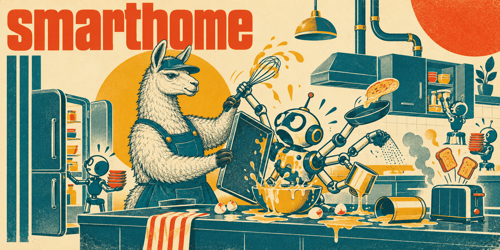

# Smart home skills

A mixed smart home centred on Home Assistant: the HA installation itself, its
automations and community extensions, the radio networks, the device families, and
the FRITZ!Box that most German homes have in the middle of it. Reference skills — they
describe how the products and protocols behave, not a house choice — so none carries
the `getty-` prefix.

No skill here carries a specific household. A home's actual inventory, entity IDs and
topology belong in the repository that holds its configuration; the skills treat any
inventory they are given as a report to verify, never as a discovery.

What the skills share:

- **Exact identity before advice.** Model, hardware revision, firmware, transport and
  integration version are recorded first. A brand is not a radio, a logo is not
  feature support, and a successful pairing proves only part of the chain.
- **One owner per actuator.** Device schedules, vendor bridges, HA automations and
  physical controls are mapped, and only one of them controls an output at a time.
- **Read before you change.** Diagnostics are exported before re-pairing, one device is
  piloted before a fleet, and working physical controls and recovery paths are
  preserved. Credentials, network keys and camera URLs stay out of deliverables.
- **Dated evidence.** Each skill names its research snapshot; firsthand community
  reports are kept apart from documented behaviour and rechecked against the installed
  release.

Rough reading order: [smart-home-architecture](smart-home-architecture/SKILL.md)
routes to the rest; [home-assistant-operator](home-assistant-operator/SKILL.md) is
the base for anything touching the running installation.

## Architecture

### [smart-home-architecture](smart-home-architecture/SKILL.md)

The whole home as independently working subsystems with explicit control ownership:
dependency maps from device through radio or hub, integration and automation to
actuator; protocol and hub choice (Zigbee, Matter, Thread, BLE, Wi-Fi, wired buses);
LAN, discovery, VLANs and remote access; evaluating an Amazon listing or a product
family; resilience, acceptance and migration checks. Routes to the other eight skills.
Ships a device evidence record template.

**Load when** designing, expanding or migrating a smart home, choosing protocols or
hubs, or comparing products before buying.

## Home Assistant

### [home-assistant-operator](home-assistant-operator/SKILL.md)

Running Home Assistant: HAOS versus Container, Core and Supervisor, apps and add-ons,
backup and host migration, device and entity registries, REST and WebSocket APIs with
authentication, recorder and statistics growth, discovery and remote access,
performance, and custom integration development. Devices, config entries, registry
records and entities are four different things. Ships a read-only snapshot script.

**Load when** installing, upgrading, backing up, migrating or debugging a Home
Assistant installation, or giving an agent API access to it.

### [home-assistant-automations](home-assistant-automations/SKILL.md)

Household behaviour as a contract: states, transitions, guards, timeouts and recovery,
written before the YAML. Covers triggers and run modes, templates and unavailable
inputs, restart-safe timing, lighting with manual override, heating and leak response,
presence from router trackers, dashboards and energy, and Assist or MCP agents with
explicit authority. Ships scenario templates and a restart-safe light session.

**Load when** writing or debugging an automation, script, scene, blueprint, template
or dashboard, or wiring voice or LLM control.

### [home-assistant-hacs](home-assistant-hacs/SKILL.md)

HACS as a distribution layer for community code, evaluated per project and version:
when native HA already suffices, blast radius of backend versus frontend code,
frontend resource debugging, update and recovery, and the version-gated Marketplace
transition. A curated catalogue covers the common cards, Adaptive Lighting, thermostat
wrappers, Scheduler and the Tuya, SONOFF and Govee bridges.

**Load when** installing, updating or removing a HACS integration, card or theme, or a
custom card fails to load.

## Network and devices

### [fritzbox-operator](fritzbox-operator/SKILL.md)

The FRITZ!Box as shared network, telephony and heating dependency: TR-064 SOAP, AHA
HTTP, the Smart Home REST API, session authentication, the HA integrations, DECT
thermostats and buttons, mesh and presence, guest isolation, provider-managed cable
firmware, telephony, NAS, VPN and recovery. Separates what the box supports, what its
firmware exposes, what the API exposes and what the HA integration implements. Ships a
read-only TR-064 inspection script.

**Load when** integrating, automating or debugging a FRITZ!Box or FRITZ! smart-home
devices.

### [smart-home-devices](smart-home-devices/SKILL.md)

Device-by-device integration decisions from exact model and fingerprint: a capability
matrix per device and route (native, Matter, HomeKit, Zigbee, BLE, MQTT, cloud,
HACS), verified in both directions — command to physical effect, physical action to
HA state. Vendor references for Hue, Shelly, THIRDREALITY, Tuya Zigbee and Wi-Fi,
SONOFF, Zengge, ThermoBeacon, Aqara/Xiaomi, OSRAM/LEDVANCE, Govee and Paulmann, plus
heating, plugs, locks, covers, presence, garden, solar and EV families.

**Load when** identifying, choosing, integrating or debugging a specific smart-home
product.

### [smart-home-radio](smart-home-radio/SKILL.md)

Radio networks: Zigbee mesh design, ZHA and Zigbee2MQTT, coordinators and routers,
Matter commissioning with Thread and IPv6, Bluetooth proxies, Z-Wave and EnOcean.
Separates exact-device limitations from network faults, gives one coordinator to one
stack, and keeps network keys and working pairings intact through migration.

**Load when** pairing fails, a Zigbee or Thread network is unstable, or a coordinator
or stack is being changed.

### [smart-home-esphome-mqtt](smart-home-esphome-mqtt/SKILL.md)

Local devices with ESPHome and MQTT, with firmware, transport, broker, discovery and
entities as separate layers. Board identification, native API encryption, OTA and safe
mode, Bluetooth proxies, Mosquitto design, retained messages, availability and
idempotent commands; reflashing a Shelly, SONOFF or Tuya device is a separate
decision from native support. Ships an ESP32 lab config and an MQTT discovery example.

**Load when** writing ESPHome YAML, flashing an ESP device, or designing MQTT topics and
discovery.

### [smart-home-video-media](smart-home-video-media/SKILL.md)

Cameras, NVRs, doorbells and media with control, events, video, recording, audio, wake
and notifications kept apart. Reolink cameras, NVR revisions, doorbells and chimes;
RTSP, ONVIF, WebRTC, go2rtc and Frigate; LG webOS, Fire TV, Android TV, Sonos and
Music Assistant. A working picture establishes only one of those paths.

**Load when** integrating or debugging a camera, NVR, doorbell, TV or media player in
Home Assistant.
